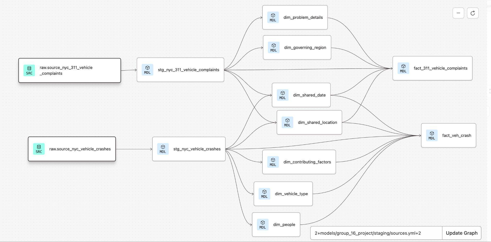
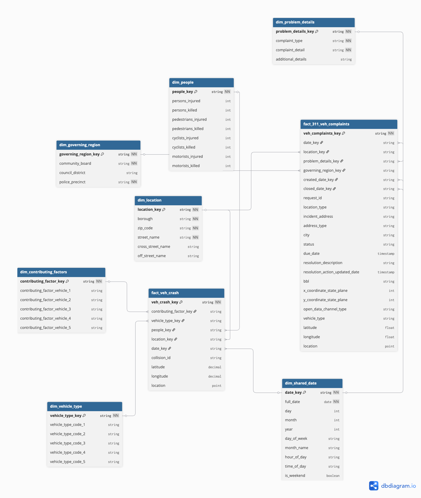
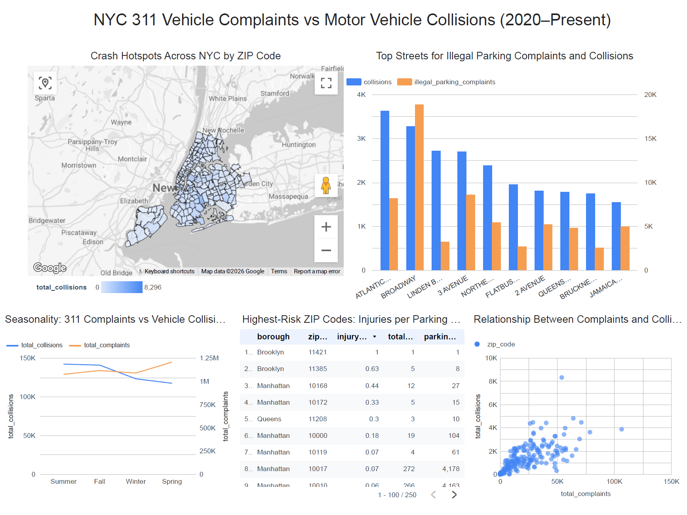

# NYC 311 Vehicle Complaints vs. Motor Vehicle Collisions

**Author:** Victor Chen

## Project Overview

This project investigates whether NYC 311 vehicle-related service complaints can help explain motor vehicle collision patterns across New York City and support the prioritization of traffic-safety investigations.

Two NYC Open Data datasets are brought together in a BigQuery data warehouse using Python, Google Cloud Functions, Cloud Scheduler, and dbt. Shared date and location dimensions support comparisons of complaints and crashes by borough, ZIP code, street, and time period. A Looker Studio dashboard presents the resulting analysis.

Potential stakeholders include the NYC Department of Transportation and NYPD Traffic Enforcement. The analysis could inform decisions about enforcement resource allocation, street-safety redesign, and complaint resolution in areas with elevated collision activity.

## Analytics Questions

- Is there a geographic correlation between specific types of 311 complaints received by NYPD and motor vehicle collisions?
- How can NYC 311 service complaints be used to help prevent or reduce vehicle collisions across NYC?

## Data Sources

| Dataset | Scope | Record Grain |
| --- | --- | --- |
| [NYC 311 Service Requests](https://data.cityofnewyork.us/Social-Services/311-Service-Requests-from-2010-to-Present/erm2-nwe9) | NYPD-handled vehicle-related complaints | One service request |
| [Motor Vehicle Collisions – Crashes](https://data.cityofnewyork.us/Public-Safety/Motor-Vehicle-Collisions-Crashes/h9gi-nx95) | Police-reported motor vehicle collisions | One crash event |

The complaint categories are **Illegal Parking, Blocked Driveway, Abandoned Vehicle, Noise - Vehicle, and Traffic**. The report records January 2026 as the data-source access date.

## Technologies and ELT Pipeline

| Stage | Tools | Purpose |
| --- | --- | --- |
| Extract | Socrata API, Python, Google Cloud Functions, Cloud Scheduler | Retrieve data from NYC Open Data and automate retrieval |
| Load | Google BigQuery | Store raw source tables |
| Transform | dbt, SQL, GitHub | Clean and standardize data and build dimensional models |
| Analyze and visualize | BigQuery KPI tables, Looker Studio | Compare complaint activity with crash outcomes |

The staging layer standardizes data types, handles null values, and addresses inconsistencies. The marts layer contains dimension and fact tables linked through surrogate keys. Calculated date fields support time-based analysis.

The warehouse is organized into the following datasets:

- **Raw:** `group16_nyc_open_data_raw_dataset`
- **Staging:** `nyc_crashes_complaints_staging`
- **Marts:** `nyc_crashes_complaints_marts`

### dbt Lineage

## Dimensional Model

The warehouse contains two data marts that support both source-specific and combined analysis.

| Data Mart | Fact Table | Grain | Dimensions |
| --- | --- | --- | --- |
| 311 Vehicle Complaints | `fact_311_veh_complaints` | One vehicle-related service request | Date, location, problem details, governing region |
| Motor Vehicle Collisions | `fact_veh_crash` | One reported motor vehicle collision | Date, location, contributing factors, vehicle type, people |

The conformed dimensions `dim_shared_date` and `dim_shared_location` enable comparisons across common dates and locations.

## Metrics

- **Complaint-to-crash ratio:** Vehicle-related 311 complaints relative to crashes, by street and complaint type.
- **Crash severity in high-complaint areas:** Persons injured or killed at locations with frequent complaints.
- **Injury per complaint rate:** Pedestrian and cyclist injuries relative to parking complaint volume.

## Dashboard and Visualizations

The Looker Studio dashboard uses cross-mart KPI tables in BigQuery to compare complaints and crash outcomes by ZIP code, street, and seasonal timing.

| Visualization | Purpose |
| --- | --- |
| [Crash Hotspots Across NYC by ZIP Code](docs/images/crash_hotspots_by_zip.png) | Identify geographic concentrations of collisions |
| [Top Streets for Illegal Parking Complaints and Collisions](docs/images/parking_complaints_and_collisions_by_street.png) | Compare complaints and collisions on streets ranked by collision counts |
| [Seasonality: 311 Complaints vs. Vehicle Collisions](docs/images/seasonal_comparison.png) | Compare complaint and collision volumes across seasons |
| [Highest-Risk ZIP Codes: Injuries per Parking Complaint](docs/images/injuries_per_parking_complaint.png) | Examine pedestrian and cyclist injuries relative to parking complaints |
| [Relationship Between Complaints and Collisions by ZIP](docs/images/complaints_vs_collisions_by_zip.png) | Explore the relationship between complaint and collision volumes |

## Findings

The report describes a generally positive relationship between complaint and collision volumes in the ZIP-level scatter plot. The hotspot map and street comparisons also indicate that crashes and complaints cluster geographically.

These findings suggest a way to screen locations for further investigation: prioritize ZIP codes and streets with substantial complaint-and-collision overlap, and examine locations with high injury-to-complaint ratios. The report does not establish a definitive correlation; it presents this approach as a way to identify locations deserving closer attention.

## Limitations and Follow-Up Analysis

The analysis is constrained by incomplete location fields and the need to aggregate results at ZIP-code and street levels.

The report recommends:

1. Repeating hotspot and injury analyses at a finer geographic level, such as neighborhoods.
2. Testing whether complaint spikes precede collision spikes using weekly or monthly observations.
3. Comparing additional complaint categories beyond illegal parking.

## Project Report

[Read the original project report](docs/original_project_report.pdf)
